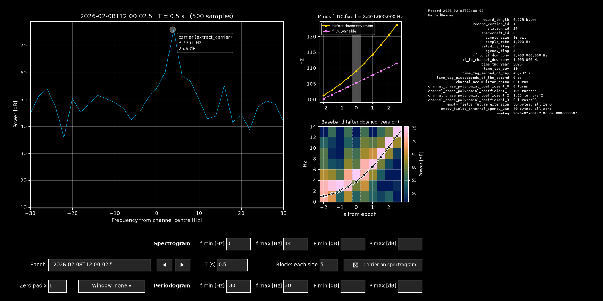

Browsing a file
===============

:func:`rdefpy.browse` opens an interactive matplotlib window on a product
file around an epoch: the spectrum of the samples, the carrier from
:func:`rdefpy.extract_carrier` over a few blocks, and the record headers.
It needs matplotlib: ``pip install "rdefpy[browse]"``.

.. code-block:: python

   from rdefpy import browse, read_product

   pf = read_product("scan.prd")
   fig = browse(pf, epoch="2026-02-08T12:00:00.5", integration_time=0.5)

``epoch`` is the initial centre of the window (default: the middle of the
first record), ``integration_time`` the window length T in seconds and
``blocks`` (default 5) the number of carrier blocks on each side. All three
can be changed in the window.

         with its colour bar in the middle, record header on the right,
         input cells below.

   The browser on a synthetic file, T = 0.5 s.

The browser shows the interval [epoch − T/2, epoch + T/2), in the time
scale of the record time tags; ``T * sample_rate`` must be a whole number
of samples. When the interval is not inside the file, crosses a gap or
crosses a sample-rate change, or a cell holds a bad value, nothing new is
drawn and a red title on the spectrum says why.

Panels
------

* **Spectrum** (left): power of the samples in the window, in dB, against
  frequency from the channel centre. A dot marks the carrier of the window
  block, with its baseband frequency and power.
* **Carrier** (middle): :func:`rdefpy.extract_carrier` on the window and on
  up to ``blocks`` blocks each side. The top panel shows the frequency
  before downconversion and the variable part of the downconversion
  frequency, both minus the fixed part given in the title
  (:doc:`downconversion`). The lower panel shows the baseband frequency of
  each block over a spectrogram of the same blocks, in the batlow colour
  map of Crameri (2018).
* **Headers** (right): the header of the first record the window touches,
  then, for each further record, the lines that differ from it.

A readout line under the spectrum shows the values under the mouse.

Controls
--------

* **Epoch**, **T [s]**: centre and length of the window. The ◀ ▶ buttons
  and the left and right arrow keys move the epoch by T.
* **Blocks each side**: carrier blocks before and after the window.
* **Zero pad x**: an integer from 1 to 10, for the spectrum, the
  spectrogram and the carrier estimate (``zero_padding`` of
  :func:`rdefpy.extract_carrier`).
* **Window**: none, Hann, Hamming, Blackman, Kaiser (β = 8) or Chebyshev
  (100 dB), for the spectrum and the spectrogram only. The carrier estimate
  is never windowed (:doc:`samples_and_time`).
* **Periodogram**, **Spectrogram**: four cells each, **f min**, **f max**
  [Hz] and **P min**, **P max** [dB]. A blank cell is automatic.
* **Carrier on spectrogram**: shows or hides the carrier estimates drawn
  over the spectrogram.

Tab and Enter apply a cell; Tab moves to the next one, Shift+Tab back.

Records are read only when a window touches them, and the cache of decoded
records, spectra and carrier blocks is limited to 1 GiB, so browsing a long
file does not load it.

Crameri, F. (2018), Scientific colour maps, Zenodo,
https://doi.org/10.5281/zenodo.1243862.
