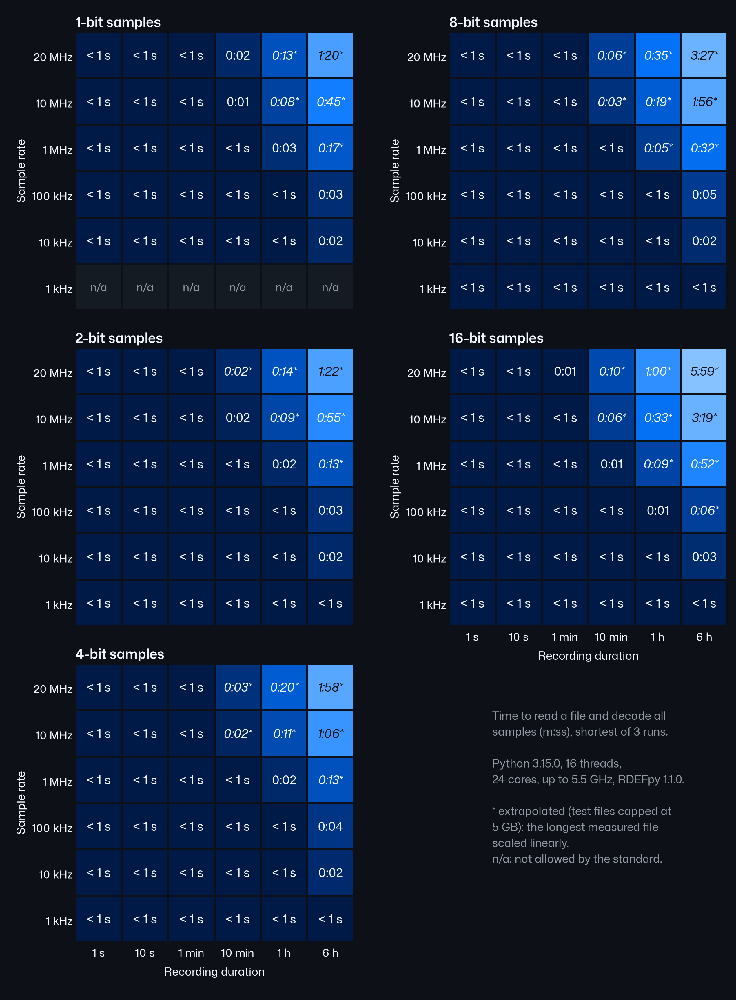
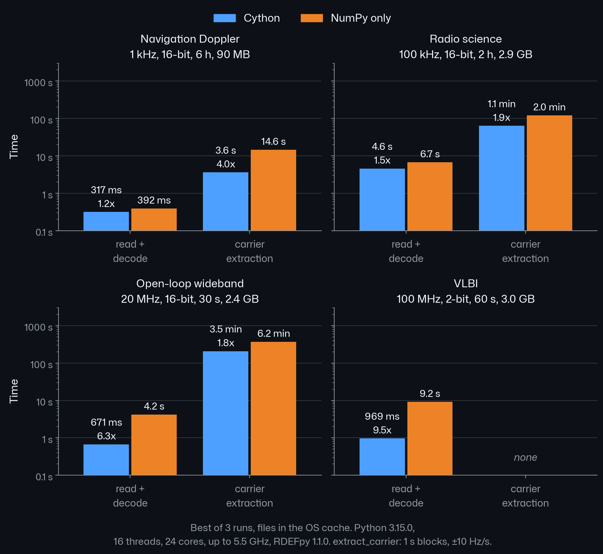

Performance
===========

Product files run to gigabytes: a 20 Msps, 16-bit recording is 80 MB per
second of data, and decoded to complex128 it is 320 MB per record. RDEFpy
keeps memory bounded by leaving records above 1 kHz on disk until accessed
(:doc:`product_files`).

.. code-block:: python

   import numpy as np
   import rdefpy

   rdefpy.set_threads(4)                 # None: back to the default
   pf = rdefpy.read_product("scan.prd", dtype=np.complex64)
   buf = None
   for rec in pf:                        # one record in memory at a time
       buf = rec.read_samples(out=buf)   # one reused array; copy what you keep

Large files
-----------

* Iterate; do not ``pf.load()``, which costs the decoded size of the whole
  file.
* Take ``d = rec.data`` once per record, or use
  ``rec.read_samples(out=buf)`` with one reused buffer.
* ``dtype=np.complex64`` is lossless and halves the memory.
* Select before you read: ``band``, ``start_epoch`` / ``stop_epoch`` and
  header ``filters`` skip records without reading their data.
* :func:`rdefpy.read_headers`, :func:`rdefpy.scan_product`, ``len(rec)``,
  ``pf.timetags``, ``pf.timetag_array`` and the downconversion views never
  touch the samples.
* Ask for the range you need, ``pf.samples[a:b]`` or a strided slice, not
  ``np.asarray(pf.samples)``.
* :func:`rdefpy.extract_carrier` makes one pass and bounds its memory with
  ``memory_limit`` (:doc:`carrier`).

Threads
-------

Large reads, decodes and complex builds run on a thread pool.
:func:`rdefpy.set_threads` sets its size for later calls. The default is 16
threads on a machine with at least 24 cores, otherwise 8, or one per core
below 8.

Decodes and complex builds of at least 4 million samples are split, and
data sections of at least 8 MiB are read in parallel slices; smaller records
run in the calling thread. When records are read one after another in file
order, the next data section of at least 512 KiB is read ahead on a
background thread while the current one is decoded: in our measurements
this made a full decode of records from 512 KiB 20-40 % faster, with the
file already in the operating system's cache.

Cython extension or NumPy
-------------------------

An optional Cython extension speeds up I/Q unpacking and carrier
extraction; without it RDEFpy uses an equivalent pure-NumPy path. Both
return the same arrays (the test suite compares them for every sample
size). See :doc:`../installation` for how to check which one is active.

Benchmarks
----------

Time to read a file and decode every sample to integer I/Q, by sample size,
sample rate and recording duration. Shortest of 3 runs, files in the OS
cache. A 24-core laptop CPU at up to 5.5 GHz, Windows 11, Python 3.15.0,
NumPy 2.5.4, RDEFpy 1.1.0 with the Cython extension, 16 threads. Test files are up to 5 GB; longer recordings
(marked \*) are scaled linearly from the longest measured file.

Four typical files, with and without the compiled Cython extension (without
it RDEFpy falls back to pure NumPy): the time to read and decode the file
to complex samples (``rec.read_samples()``, the decode
:func:`rdefpy.extract_carrier` runs; integer I/Q for the VLBI file), and
the time :func:`rdefpy.extract_carrier` then adds (1 s blocks, ±10 Hz/s,
default ``memory_limit``; not run on the VLBI file, "none"). Best of 3
runs, files in the OS cache, same machine and versions,
RDEFpy 1.1.0.

Your numbers depend on the disk, the cache state and the core count.
